# Ficha 06 - Jenkins (exercicios 4 a 9)

API FastAPI simples usada para a ficha de Jenkins. Aqui ficam os prints e notas dos exercicios 4 ao 9.

Nota: no meu setup o Jenkins está na porta 8100 em vez da 8080.

---

## Exercicio 04 - Primeira pipeline declarativa

Criei um job do tipo Pipeline chamado `pipeline-inicial` e colei o script da ficha em Pipeline script.

O que percebi de cada parte:
- `agent { label 'ci-python-docker' }` - diz que corre no agente e nao no controller
- `stages` / `stage` - as etapas que aparecem no Pipeline Overview
- `steps` - os comandos de cada etapa
- `post` - corre no fim, depende se correu bem ou mal

### Build #1 - correu bem

As 4 etapas passaram e o `resultado.txt` ficou como artefacto (tem `Estado: OK` lá dentro).

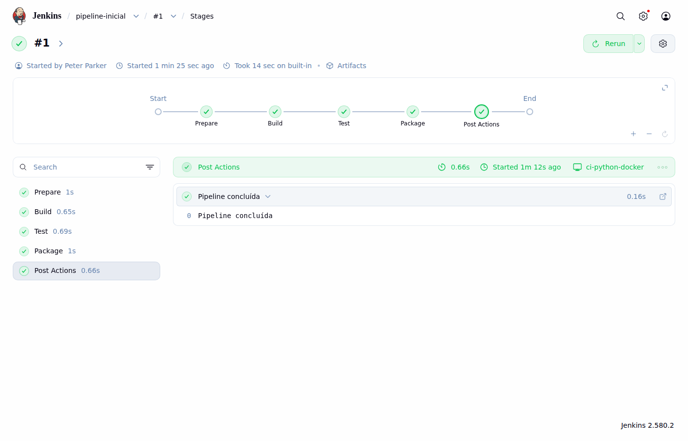

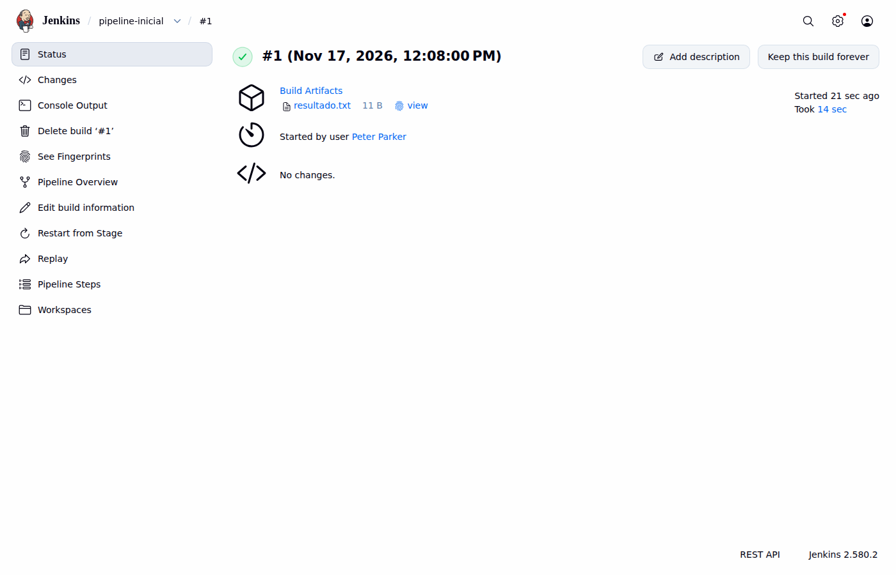

### Build #2 - falha de proposito

Mudei so o grep para procurar `Estado: FALHOU`. Como o texto nao existe no ficheiro o grep da exit 1 e o Test falha. O Package nem corre.

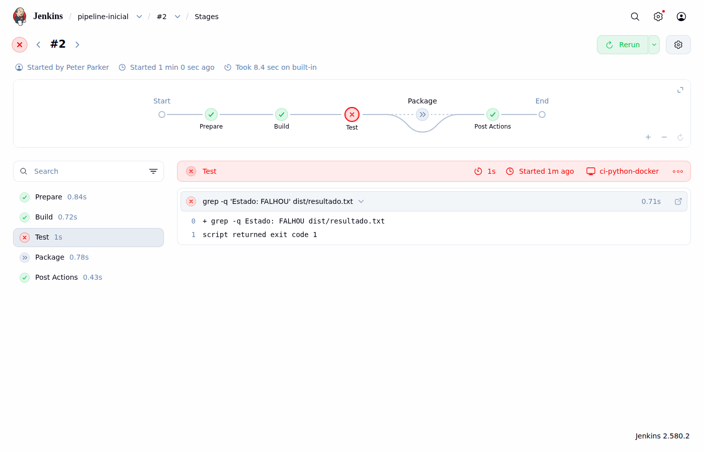

```
[Pipeline] { (Test)
+ grep -q Estado: FALHOU dist/resultado.txt
[Pipeline] { (Package)
Stage "Package" skipped due to earlier failure(s)
[Pipeline] { (Declarative: Post Actions)
Pipeline com erro
ERROR: script returned exit code 1
Finished: FAILURE
```

### Build #3

Pus outra vez `Estado: OK` e voltou a dar SUCCESS.

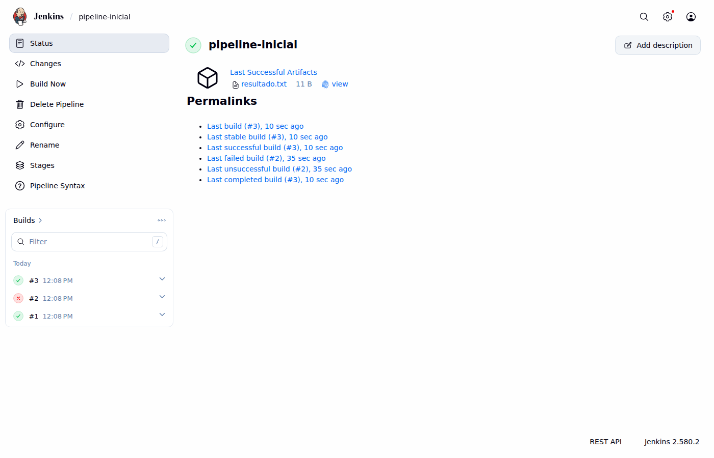

---

## Exercicio 05 - App FastAPI no Git

Criei os ficheiros todos como estao na ficha:

```
jenkins-demo-api/
├── app/
│   ├── __init__.py
│   └── main.py
├── tests/
│   └── test_main.py
├── requirements.txt
├── requirements-dev.txt
├── Dockerfile
├── .dockerignore
├── .gitignore
└── Jenkinsfile
```

Repo: https://github.com/PedroRaposo02/jenkins-demo-api (publico, assim o Jenkins faz clone sem precisar de credenciais)

```
git init -b main
git add .
git commit -m "Initial FastAPI CI project"
git remote add origin git@github.com:PedroRaposo02/jenkins-demo-api.git
git push -u origin main
```

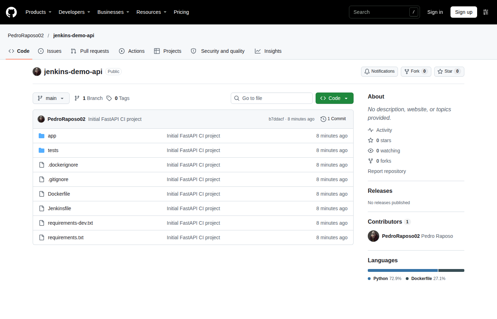

O `.gitignore` tem `.venv/`, `reports/` e `.env` por isso nao vai nada sensivel para o git.

---

## Exercicio 06 - CI com Git, pytest e JUnit

Job `fastapi-ci` do tipo Pipeline:
- Definition: Pipeline script from SCM
- SCM: Git - `https://github.com/PedroRaposo02/jenkins-demo-api.git`
- Credentials: nenhuma
- Branch: `*/main`
- Script Path: `Jenkinsfile`

### Build #1 - SUCCESS

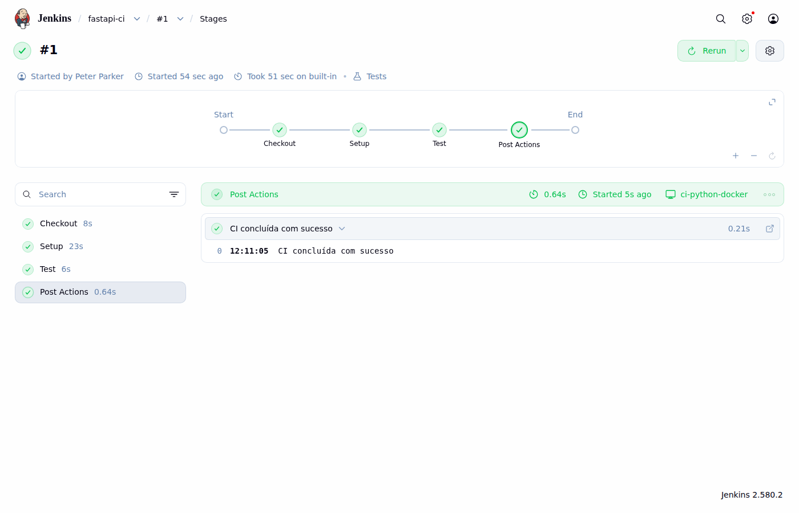

Relatorio JUnit com os 2 testes a passar:

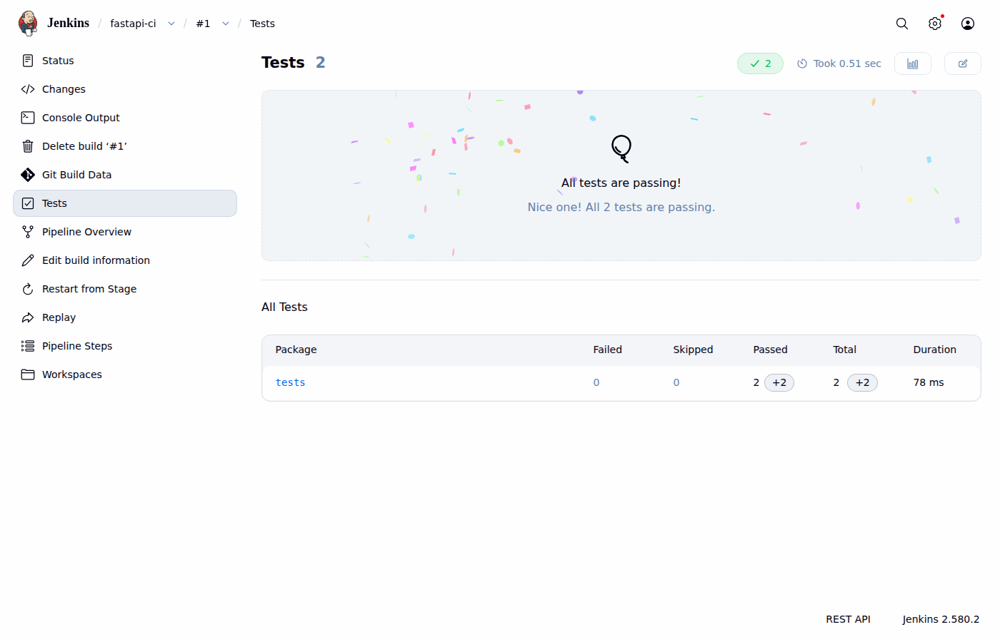

Console output:

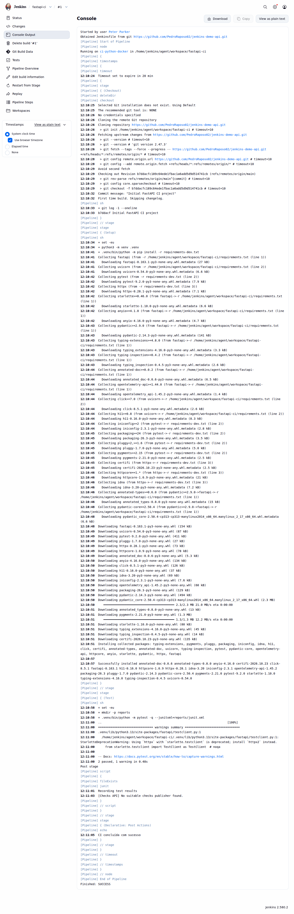

Partes importantes do log:
```
Obtained Jenkinsfile from git https://github.com/PedroRaposo02/jenkins-demo-api.git
Running on ci-python-docker in /home/jenkins/agent/workspace/fastapi-ci
Checking out Revision b7ddacfc189c64ede1fbac1a6add5d9d514741cb (refs/remotes/origin/main)
+ git log -1 --oneline
b7ddacf Initial FastAPI CI project
...
+ .venv/bin/python -m pytest -q --junitxml=reports/junit.xml
..                                                                       [100%]
2 passed, 1 warning in 0.48s
Recording test results
CI concluída com sucesso
Finished: SUCCESS
```

O commit usado é o `b7ddacf` e o `reports/junit.xml` foi criado (é o que aparece no "Recording test results").

---

## Exercicio 07 - Docker build

Liguei o docker-engine na pasta `infra`:
```
$ docker compose --profile docker-build up -d docker-engine
 Container jenkins-docker-lab  Started

$ docker compose --profile docker-build ps
NAME                 IMAGE                       SERVICE         STATUS
jenkins-ci-agent     infra-ci-agent              ci-agent        Up 27 minutes
jenkins-docker-lab   docker:28-dind              docker-engine   Up 1 second
jenkins-lab          jenkins/jenkins:lts-jdk21   jenkins         Up About an hour
```

Quando fui testar o `docker version` no agente deu `exec: "docker": executable file not found in $PATH`. Fui ver e no Debian 13 (que é a base da imagem do agente) o pacote `docker.io` so tem o daemon, o comando `docker` esta no pacote `docker-cli`. Como o Dockerfile usa `--no-install-recommends` nao foi instalado. Acrescentei `docker-cli` no `Dockerfile.agent`:

```dockerfile
 curl ca-certificates docker.io docker-cli \
```
e fiz `docker compose up -d --build ci-agent`. Depois ja funcionou:

```
$ docker exec jenkins-ci-agent docker version
Client:
 Version:           26.1.5+dfsg1
 API version:       1.45
Server: Docker Engine - Community
 Engine:
  Version:          28.5.2
  API version:      1.51 (minimum version 1.24)
```

Depois acrescentei as etapas Docker Preflight, Docker Build e Verify Image no Jenkinsfile, fiz commit e push e corri outra vez.

### Build #2 - 6 etapas OK

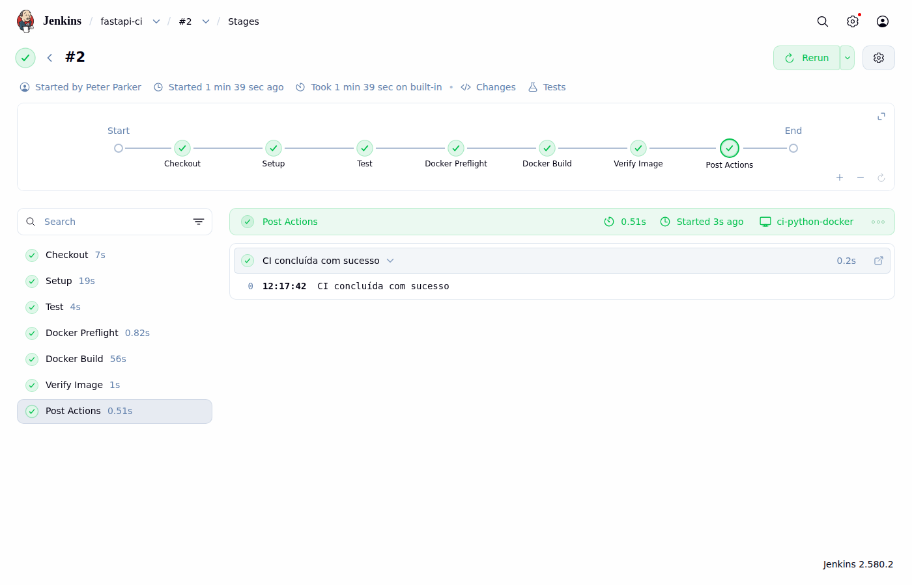

```
+ docker info --format {{.ServerVersion}}
28.5.2
+ test -f Dockerfile
...
+ docker build -t jenkins-demo-api:2 .
Successfully built d9a0f910ef80
Successfully tagged jenkins-demo-api:2
...
+ docker image inspect --format {{.Id}} jenkins-demo-api:2
sha256:d9a0f910ef80de9cba61717bab45b13c3c4ff8347b5b310c87a49a95e483b23c
Finished: SUCCESS
```

Imagem vista pelo agente (fica no docker do lab, nao no do meu pc):
```
$ docker exec jenkins-ci-agent docker image ls jenkins-demo-api
REPOSITORY         TAG       IMAGE ID       CREATED          SIZE
jenkins-demo-api   2         d9a0f910ef80   26 seconds ago   144MB

$ docker exec jenkins-ci-agent docker image inspect --format '{{.Id}}' jenkins-demo-api:2
sha256:d9a0f910ef80de9cba61717bab45b13c3c4ff8347b5b310c87a49a95e483b23c
```

---

## Exercicio 08 - Troubleshooting

| Build | O que fiz | Resultado |
|---|---|---|
| #3 | A - /health devolve error | FAILURE |
| #4 | A - corrigido | SUCCESS |
| #5 | B - branch que nao existe | FAILURE |
| #6 | B - corrigido | SUCCESS |
| #7 | C - docker engine parado | FAILURE |
| #8 | C - corrigido | SUCCESS |
| #9 | D - agente parado | ficou em fila, depois SUCCESS |

### Incidente A - erro na app

Mudei o `/health` para `return {"status": "error"}`, commit + push e corri o job.

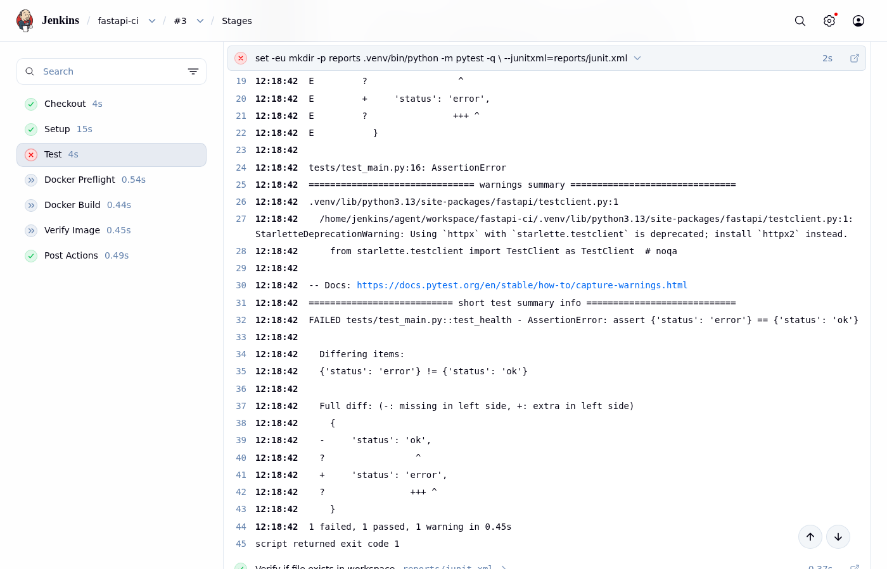

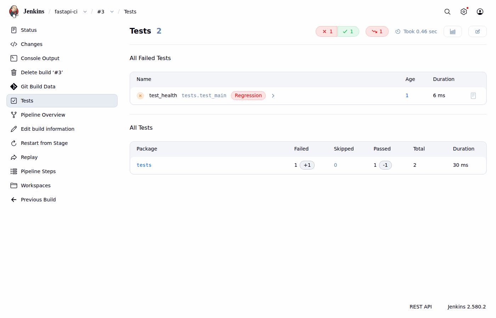

```
E       AssertionError: assert {'status': 'error'} == {'status': 'ok'}
FAILED tests/test_main.py::test_health - AssertionError: assert {'status': 'error'} == {'status': 'ok'}
1 failed, 1 passed, 1 warning in 0.45s
Stage "Docker Preflight" skipped due to earlier failure(s)
Stage "Docker Build" skipped due to earlier failure(s)
Stage "Verify Image" skipped due to earlier failure(s)
Finished: FAILURE
```

Voltei a por `"ok"`, commit + push e o #4 passou.

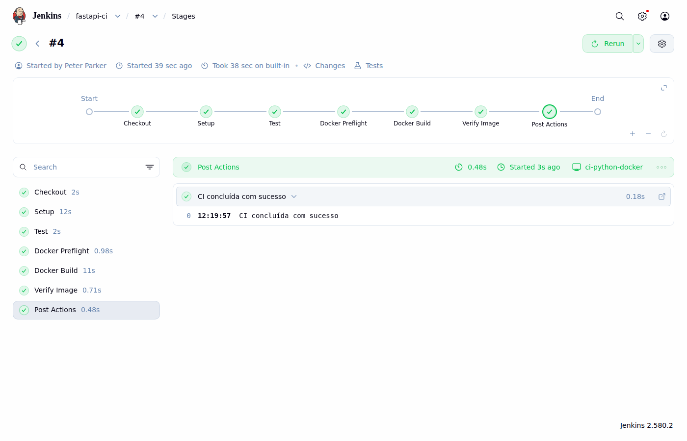

### Incidente B - branch errada

Na config do job pus `*/branch-inexistente`.

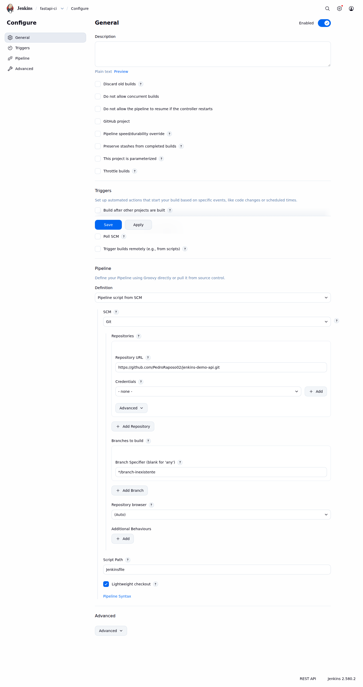

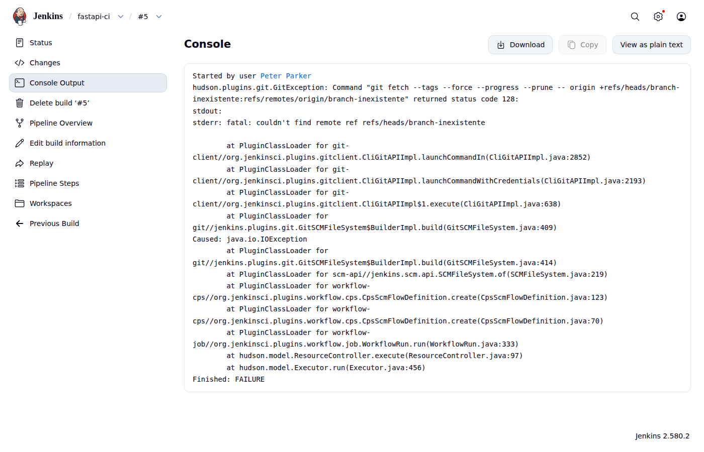

```
hudson.plugins.git.GitException: Command "git fetch ... +refs/heads/branch-inexistente:refs/remotes/origin/branch-inexistente" returned status code 128:
stderr: fatal: couldn't find remote ref refs/heads/branch-inexistente
Finished: FAILURE
```

Falha logo no inicio, antes de qualquer stage, porque o jenkins nem consegue ir buscar o Jenkinsfile. Voltei a por `*/main` e o #6 passou.

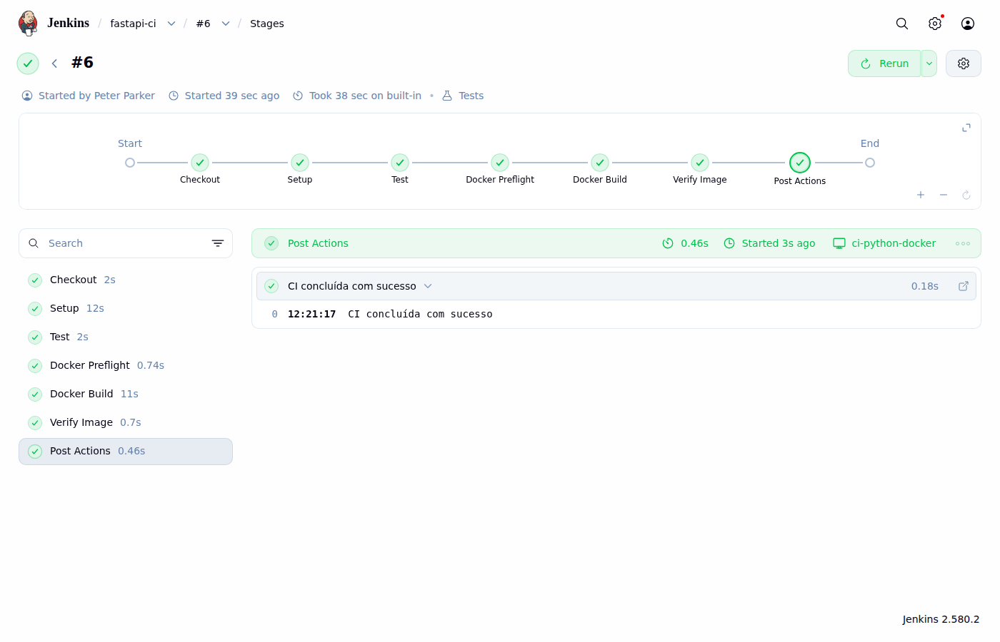

### Incidente C - docker parado

```
$ docker compose --profile docker-build stop docker-engine
 Container jenkins-docker-lab  Stopped
```

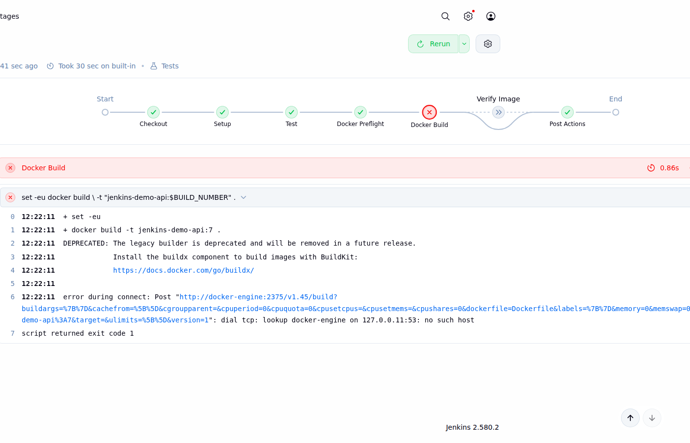

```
2 passed, 1 warning in 0.34s
[Pipeline] { (Docker Preflight)
+ docker info --format {{.ServerVersion}}
error during connect: Get "http://docker-engine:2375/v1.45/info": dial tcp: lookup docker-engine on 127.0.0.11:53: no such host
+ test -f Dockerfile
[Pipeline] { (Docker Build)
+ docker build -t jenkins-demo-api:7 .
error during connect: Post "http://docker-engine:2375/v1.45/build?...": dial tcp: lookup docker-engine on 127.0.0.11:53: no such host
Finished: FAILURE
```

Os testes passaram como era suposto, mas reparei que o Preflight ficou verde e quem falhou foi o Docker Build. Fui testar no agente e o `docker info --format ...` mostra o erro mas sai com exit code 0, por isso o `set -eu` nao apanha. Ja o `docker version` sai com 1:

```
docker info --format ...     -> exit 0
docker info                  -> exit 1
docker version --format ...  -> exit 1
```

Logs:
```
$ docker compose logs --tail=15 ci-agent
jenkins-ci-agent  | INFO: Connected

$ docker compose --profile docker-build ps -a docker-engine
jenkins-docker-lab   docker:28-dind   ...   Exited (0) 54 seconds ago

$ docker compose --profile docker-build logs --tail=10 docker-engine
jenkins-docker-lab  | level=info msg="Processing signal 'terminated'"
jenkins-docker-lab  | level=info msg="Daemon shutdown complete"
```
O agente estava ligado, o engine é que estava parado. O "no such host" é porque com o container parado o nome `docker-engine` deixa de existir na rede.

```
$ docker compose --profile docker-build start docker-engine
 Container jenkins-docker-lab  Started
```
O #8 passou com as 6 etapas.

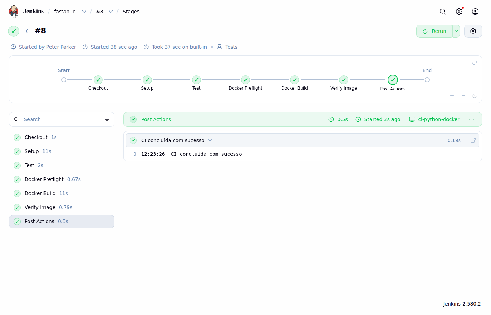

### Incidente D - agente parado

```
$ docker compose stop ci-agent
```
Fiz Build Now e o build #9 ficou parado na fila com a mensagem `‘ci-python-docker’ is offline`.

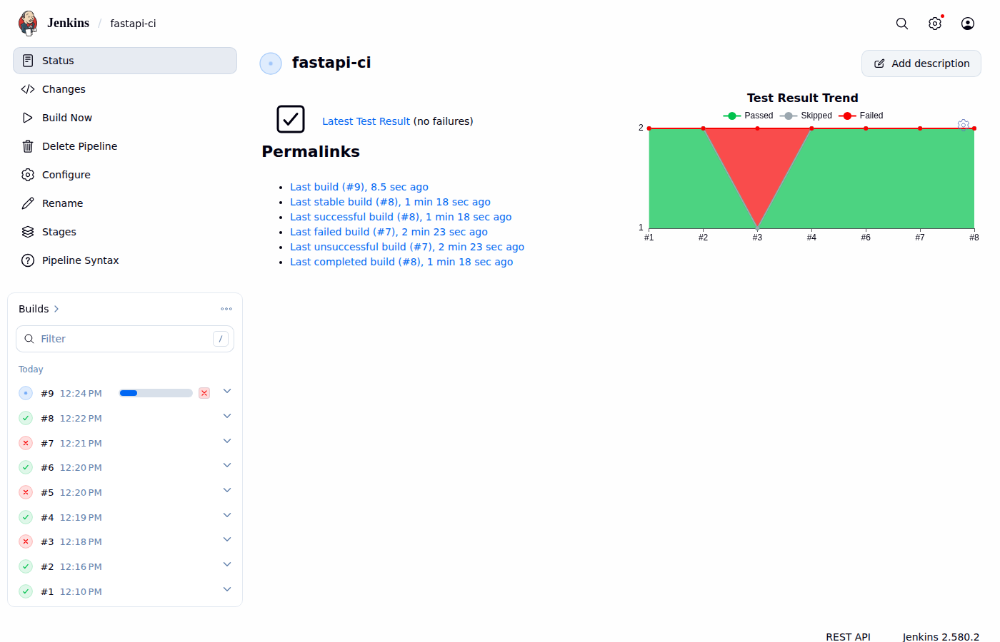

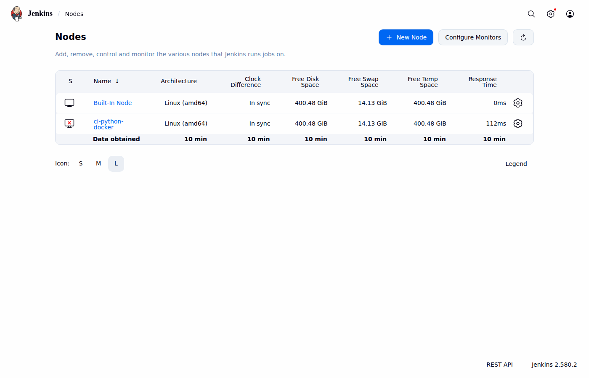

```
$ docker compose start ci-agent
```
Quando o agente voltou o build arrancou sozinho e deu SUCCESS.


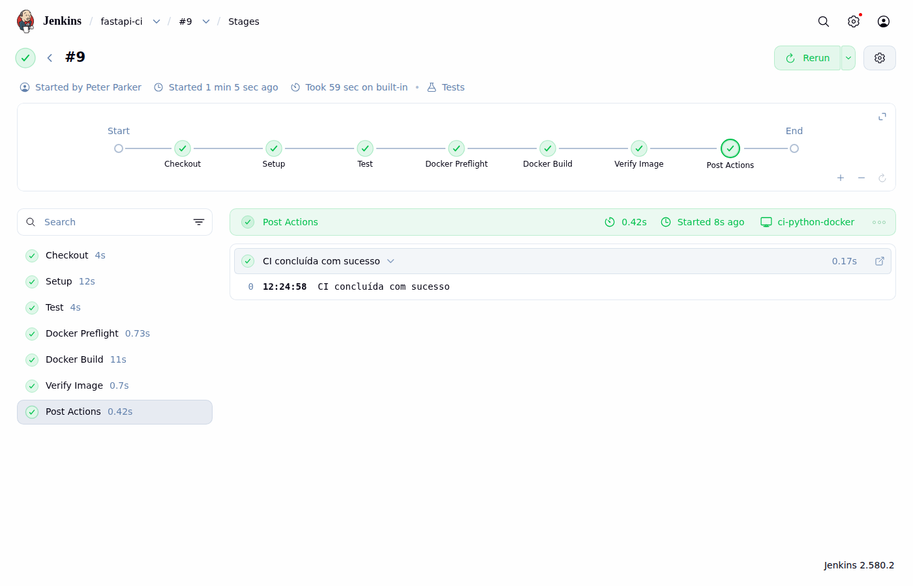

### Relatorio de incidente 1 (A)

| Campo | Informação |
|---|---|
| Job / Build | fastapi-ci #3 |
| Etapa afetada | Test (as etapas docker foram saltadas) |
| Sintoma | `AssertionError: assert {'status': 'error'} == {'status': 'ok'}` |
| Evidência | Console output e relatorio JUnit (test_health falhou) |
| Causa identificada | Mudei o /health para devolver "error" e o teste espera "ok". É um erro da app |
| Ação corretiva | Voltar a por "ok", commit e push |
| Validação | Build #4 SUCCESS, 2 testes passam |
| Prevenção | Correr o pytest no pc antes de fazer push |

### Relatorio de incidente 2 (C)

| Campo | Informação |
|---|---|
| Job / Build | fastapi-ci #7 |
| Etapa afetada | Docker Build (o Preflight devia ter falhado mas passou) |
| Sintoma | `dial tcp: lookup docker-engine on 127.0.0.11:53: no such host` |
| Evidência | Console output, `docker compose ps -a` com o engine Exited, log do engine "Daemon shutdown complete" |
| Causa identificada | O docker-engine estava parado, o agente nao tinha daemon para fazer o build. Erro de infraestrutura, os testes passaram |
| Ação corretiva | `docker compose --profile docker-build start docker-engine` |
| Validação | Build #8 SUCCESS com 6 etapas |
| Prevenção | Mudar o Preflight para usar `docker version` em vez de `docker info --format`, assim falha logo no Preflight |

---

## Exercicio 09 - Credenciais

Criei em Manage Jenkins > Credentials uma credencial Secret text com ID `demo-token-lab` e um valor inventado.

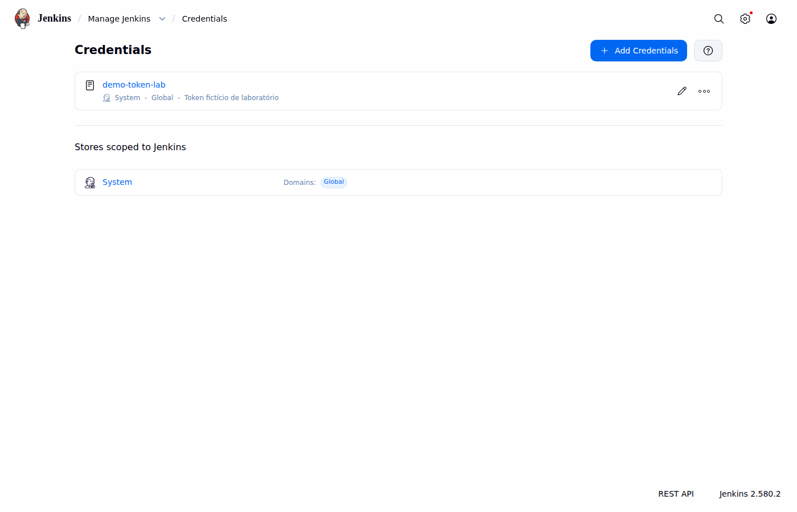

Depois criei o job `credentials-demo` com o script da ficha e correu bem. O valor nao aparece no log:

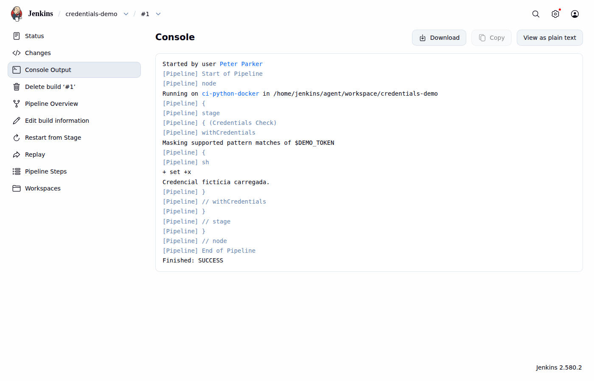

```
Masking supported pattern matches of $DEMO_TOKEN
+ set +x
Credencial fictícia carregada.
Finished: SUCCESS
```

A pipeline usa a credencial pelo ID e o segredo nunca está no codigo. O jenkins esconde o valor se aparecer no log e o `set +x` faz com que a shell nao mostre os comandos.

**Opções do fastapi-ci:**
- `timestamps()` - mete a hora em cada linha do log, ajuda a ver quanto tempo demora cada coisa e a comparar com os logs dos containers
- `disableConcurrentBuilds()` - nao deixa correr 2 builds do mesmo job ao mesmo tempo, para nao estarem os dois a mexer no mesmo workspace
- `timeout(time: 20, unit: 'MINUTES')` - se o build ficar preso aborta ao fim de 20 min e nao fica a ocupar o agente

**Segredos no repo:**
```
$ git ls-files
.dockerignore
.gitignore
Dockerfile
Jenkinsfile
app/__init__.py
app/main.py
requirements-dev.txt
requirements.txt
tests/test_main.py

$ git ls-files | grep -i "\.env"
(nada)
$ git grep -nEi "password|secret|token|api_key"
(nada)
```
O `.env` com a secret do agente está na pasta `infra`, fora deste repo.

---

## Reflexão

Quando a falha é da aplicação (incidente A) o problema está no codigo e a pipeline fez o que devia, apanhou o erro nos testes antes de construir a imagem. O JUnit mostra logo qual teste falhou e porque. Quando a falha é de infraestrutura (B, C e D) o codigo esta bem, os testes ate passam ou nem chegam a correr, e o problema esta na config do job, num container parado ou no agente offline. Ai tem de se ir ver os logs dos containers e o estado dos nodes. Acho que o papel do Support Engineer é perceber rapido de que lado esta o problema olhando para a etapa que falhou e para a mensagem de erro, corrigir e confirmar com um build verde. No incidente C tambem deu para ver que nao chega olhar para as cores das etapas, o Preflight estava verde mas na verdade nao estava a validar nada.
